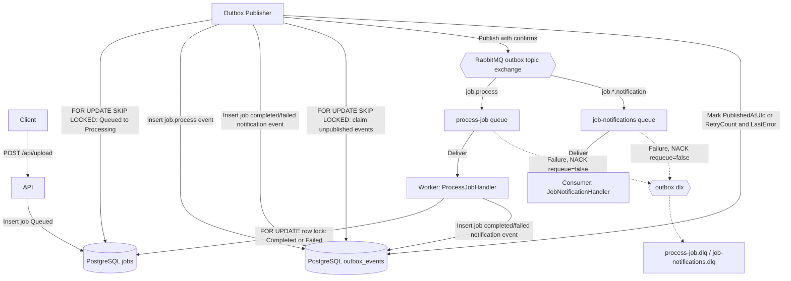

**Setup Local Development Environment**

**Local Database Setup**
1. Install Docker Desktop from [Docker's official website](https://www.docker.com/products/docker-desktop/).
2. Download posgresql image from docker hub using the command:
   ```bash
   docker pull postgres
   ```
3. Run the following command to start a PostgreSQL container:
   ```bash
       docker run -d `
        --name postgres16_wcmsdemo `
        -e POSTGRES_DB=wcmsdemo `
        -e POSTGRES_USER=postgres `
        -e POSTGRES_PASSWORD=postgres `
        -p 5432:5432 `
        -v postgres_wcmsdemo_data:/var/lib/postgresql/data `
        postgres:16
   ```
4. Create build DB from EF migration tool 
   ```bash
   dotnet ef database update `
   --project src\MessageBrokerDemo.Data\MessageBrokerDemo.Data.csproj `
   --startup-project src\MessageBrokerDemo.Api\MessageBrokerDemo.Api.csproj `
   --context WCMSDBContext
   ```

**Setup Local RabbitMQ**
1. Install Docker Desktop from [Docker's official website](https://www.docker.com/products/docker-desktop/).
2. Download rabbitmq image from docker hub using the command:
   ```bash
   docker pull rabbitmq:3-management
   ```
3. Run the following command to start a RabbitMQ container:
   ```bash
       docker run -d `
        --name rabbitmq_wcmsdemo `
        -e RABBITMQ_DEFAULT_USER=guest `
        -e RABBITMQ_DEFAULT_PASS=guest `
        -p 5672:5672 `
        -p 15672:15672 `
        rabbitmq:3-management
   ```
4. View RabbitMQ management console at [http://localhost:15672](http://localhost:15672) using the default credentials (guest/guest).

**Run OutboxPublisher Service**
1. Open a terminal and navigate to the `src/MessageBrokerDemo.Outbox` directory.
2. Run the following command to start the OutboxPublisherWorker:
   ```bash
   dotnet run
   ```

**Run Worker Service**
1. Open a terminal and navigate to the `src/MessageBrokerDemo.Worker` directory.
2. Run the following command to start the Worker:
   ```bash
   dotnet run
   ```

**Run Consumer Service**
1. Open a terminal and navigate to the `src/MessageBrokerDemo.Consumer` directory.
2. Run the following command to start the Consumer:
   ```bash
   dotnet run
   ```

**Run API**
1. Open a terminal and navigate to the `src/MessageBrokerDemo.Api` directory.
2. Run the following command to start the API:
   ```bash
   dotnet run --launch-profile https --urls "https://localhost:7077"
   ```
3. Access Swagger UI at https://localhost:7077/swagger/index.html


**MessageBroker Topology**
•	Worker: process-job queue, bound to job.process, handled by ProcessJobHandler.
•	Consumer: job-notifications queue, bound to job.*.notification, handled by JobNotificationHandler.

**Flow Diagram**

