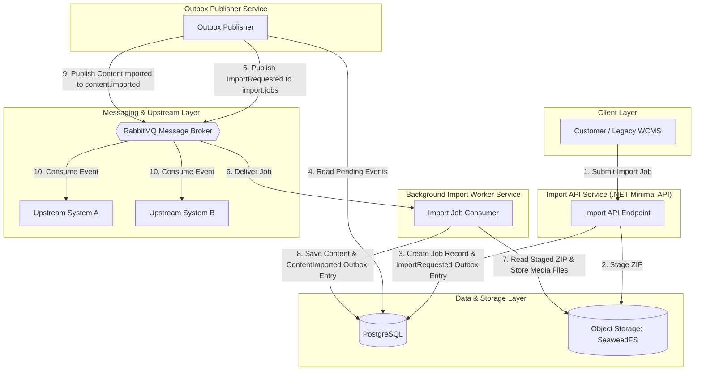

## Architectural Diagram

## Data Flow

1. A client submits an import request to the API. The API stages the uploaded ZIP file in object storage and records the import job in PostgreSQL.
2. The API records an `ImportRequested` outbox entry alongside the job record, so the job is durably recorded before asynchronous processing begins. The API can then return an accepted response (202) with the job identifier.
3. The separately hosted worker receives the job through RabbitMQ, reads the staged ZIP from object storage, validates and processes its content, stores media files in object storage, and saves content metadata and media references in PostgreSQL.
4. On successful processing, the worker records a `ContentImported` outbox entry in PostgreSQL. The binary files remain in object storage; messages carry event and job details rather than the files themselves.

The API handles request validation, staging, and job creation; it does not perform the heavy import processing. The worker runs as a separate service so it can process jobs independently of API request handling and be scaled separately.

# 